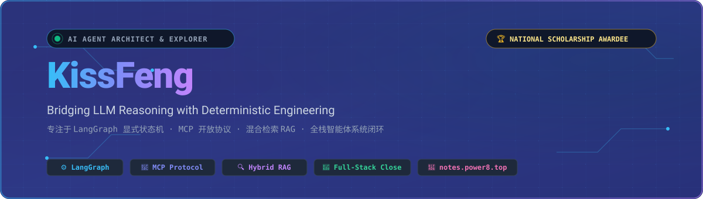

<h1 align="center">
  
  Hi there, I'm KissFeng
</h1>

  <strong>AI Agent Architecture Explorer & Full-Stack Engineer</strong>

  专注于<strong>自主智能体架构（LangGraph）</strong>、<strong>上下文工程（Context Engineering）</strong>与<strong>生产级工程落地闭环</strong>。 
  保持极客好奇心，致力于连接大模型发散推理与确定性工程控制。

  
  
  
  

  

<!-- Typing SVG Dynamic Tagline -->

---

### 💡 关于我 (About Me)

- 🔭 **前沿 Agent 架构**：较早深入自主智能体与上下文工程实践，精通 **LangGraph** 显式状态机（StateGraph）、**人机在回路（HITL）** 审批中断与 **Model Context Protocol (MCP)** 开放协议标准。
- ⚡ **高并发生产调优**：自研模型聚合路由网关，月均处理 **20~50 亿 Tokens** 真实交互，在 Token 耗时优化、流式降级、Prompt 缓存与成本归因方面拥有深度实战积累。
- 🔍 **混合检索与长记忆**：设计落地 Qdrant 稠密向量与 Rank-BM25 稀疏切片的 **双路混合检索 RAG (RRF 重排)**，结合事实无感沉淀与置信度向量消歧有效遏制模型幻觉。
- 🚀 **全栈闭环工程力**：具备企业级多租户 SaaS 从领域建模、分布式锁/多级缓存治理、支付对接到云端容器化交付从 0 到 1 的完整落地能力。
- 📖 **知识沉淀与开源精神**：搭建并维护公开知识库 [Jie's Notes](https://notes.power8.top/)，记录 AI Agent、系统底层与算法思考。

> [!NOTE]
> 🏆 **学术与科研资质背书**：
> - **2024-2025 学年 国家奖学金**（教育部颁发 · 本科阶段前 0.2% 国家级荣誉）
> - 持有 **3 项国家实用新型专利**（已授权）与 **4 项计算机软件著作权登记**

---

### 💫 专业技能矩阵 (Tech Stack & Tools)

| 领域 (Domain) | 技术栈与工具生态 (Skills & Frameworks) |
| :--- | :--- |
| **AI & Agent Core** | ![][ai-langgraph] ![][ai-claude] ![][ai-mcp] ![][ai-qdrant] ![][ai-pytorch] ![][ai-openai] ![][ai-huggingface] |
| **Backend & System** | ![][backend-python] ![][backend-fastapi] ![][backend-java] ![][backend-spring] ![][backend-mysql] ![][backend-redis] ![][backend-rabbitmq] |
| **Frontend & Workbench** | ![][frontend-react] ![][frontend-nextjs] ![][frontend-ts] ![][frontend-vue] ![][frontend-tailwind] ![][frontend-electron] ![][frontend-vite] |
| **DevOps & Infra** | ![][ops-docker] ![][ops-linux] ![][ops-nginx] ![][ops-actions] ![][ops-vercel] |
| **Workflow & IDE** | ![][tool-cursor] ![][tool-vscode] ![][tool-git] ![][tool-postman] ![][tool-macos] |

---

### 🌟 精选代表作 (Featured Projects)

#### 🤖 [NexusAgent](https://github.com/KissFeng/NexusAgent) — 基于 LangGraph 的企业级全栈智能体协同平台
> **项目发起人 · 独立全栈架构研发**
- **显式状态机与人机在回路 (HITL)**：摒弃黑盒 ReAct，采用 StateGraph 对复杂多步调用建模；实现外部 Checkpointer 快照持久化与高危工具中断等待（`interrupt` / `Command.resume` 幂等断点续跑）。
- **双路混合检索 RAG 与长记忆沉淀**：构建融合 Qdrant 稠密向量与 Rank-BM25 稀疏切片的检索体系，运用 RRF 算法综合打分召回；会话偏好动态消歧注入，有效抑制长上下文膨胀。
- **全链路追踪与容错自愈沙箱**：集成链路打点与成本归因，设计工具异常结构化自纠偏反馈回路与超时熔断保护。
- **标准 MCP 客户端网关与流式工作台**：对标 Cherry Studio 质感设计 React 19 三栏工作台，全量支持 SSE 极速流式传输与思维链折叠留痕，标准化接入本地/远程 Tool。

#### ⚡ CloudCLI (灵犀) — 基于 Claude Agent SDK 的跨端编程与多 MCP 协同系统
> **核心架构与全栈研发**
- **多会话容器与 MCP 标准适配**：基于 `@anthropic-ai/claude-agent-sdk` 封装智能体运行容器；自研面向行情订阅与多媒体处理的 stdio 进程级 MCP 服务，实现跨系统上下文动态流转。
- **Web 伪终端流式仿真与多端交付**：基于 `node-pty` 与 `@xterm/xterm`（WebGL 硬件加速）打造双向流式管道；一套工程架构无缝交付 Web 端与 Electron 桌面端，支持代码 Diff 差异审查。

#### 📖 [Jie's Notes (个人公开知识库)](https://notes.power8.top/) ｜ [GitHub 仓库](https://github.com/KissFeng/Jie-s-Notes)
> **持续生长的个人数字花园 (Digital Garden)**
- 基于 VitePress 搭建的现代化技术沉淀站点，涵盖 AI Agent 上下文工程、分布式系统高可用、底层内核技术与算法实战，记录高质量系统设计与实践心得。

#### 🛡️ [Scene-Port-Hider-by-eBPF](https://github.com/KissFeng/Scene-Port-Hider-by-eBPF)
> **底层 Linux 内核与网络安全技术探索**
- 基于 Linux eBPF 技术实现的内核态网络隐蔽机制，探索底层观测与高性能网络包过滤。

#### 📨 [GitHubTrendingBot-Feishu](https://github.com/KissFeng/GitHubTrendingBot-Feishu)
> **开发者效率工具 & 协作机器人**
- 自动化定时追踪全球 GitHub Trending 热门榜单并实时推送到飞书协作群组，助力团队敏锐洞察前沿开源趋势。

---

### 🐍 GitHub 贡献轨迹 (Contribution Snake)

  <picture>
    <source media="(prefers-color-scheme: dark)" srcset="https://raw.githubusercontent.com/KissFeng/KissFeng/output/github-contribution-grid-snake-dark.svg">
    <source media="(prefers-color-scheme: light)" srcset="https://raw.githubusercontent.com/KissFeng/KissFeng/output/github-contribution-grid-snake.svg">
    
  </picture>

---

### 📊 GitHub 动态统计 (GitHub Metrics)

  
  

  

---

  <em>“保持对前沿技术的敬畏，用确定性工程控制驱动自主思考。”</em> 
  欢迎交流与探讨，欢迎在 GitHub 上与我连接或开启合作！✨

  

<!-- SHIELD BADGE DEFINITIONS -->
[ai-langgraph]: https://img.shields.io/badge/LangGraph-000?style=flat-square&logoColor=38bdf8&logo=diagram-next
[ai-claude]: https://img.shields.io/badge/Claude_Agent_SDK-000?style=flat-square&logoColor=d97706&logo=anthropic
[ai-mcp]: https://img.shields.io/badge/MCP_Protocol-000?style=flat-square&logoColor=38bdf8&logo=connectdevelop
[ai-qdrant]: https://img.shields.io/badge/Qdrant_VectorDB-000?style=flat-square&logoColor=ef4444&logo=databricks
[ai-pytorch]: https://img.shields.io/badge/PyTorch-000?style=flat-square&logoColor=ee4c2c&logo=pytorch
[ai-openai]: https://img.shields.io/badge/OpenAI_API-000?style=flat-square&logoColor=white&logo=openai
[ai-huggingface]: https://img.shields.io/badge/HuggingFace-000?style=flat-square&logoColor=yellow&logo=huggingface

[backend-python]: https://img.shields.io/badge/Python-000?style=flat-square&logoColor=white&logo=python
[backend-fastapi]: https://img.shields.io/badge/FastAPI-000?style=flat-square&logoColor=059669&logo=fastapi
[backend-java]: https://img.shields.io/badge/Java_17%2B-000?style=flat-square&logoColor=white&logo=openjdk
[backend-spring]: https://img.shields.io/badge/Spring_Boot_3-000?style=flat-square&logoColor=6db33f&logo=springboot
[backend-mysql]: https://img.shields.io/badge/MySQL-000?style=flat-square&logoColor=white&logo=mysql
[backend-redis]: https://img.shields.io/badge/Redis-000?style=flat-square&logoColor=dc2626&logo=redis
[backend-rabbitmq]: https://img.shields.io/badge/RabbitMQ-000?style=flat-square&logoColor=ff6600&logo=rabbitmq

[frontend-react]: https://img.shields.io/badge/React_19-000?style=flat-square&logoColor=61dafb&logo=react
[frontend-nextjs]: https://img.shields.io/badge/Next.js-000?style=flat-square&logoColor=white&logo=nextdotjs
[frontend-ts]: https://img.shields.io/badge/TypeScript-000?style=flat-square&logoColor=3178c6&logo=typescript
[frontend-vue]: https://img.shields.io/badge/Vue.js_3-000?style=flat-square&logoColor=42b883&logo=vuedotjs
[frontend-tailwind]: https://img.shields.io/badge/TailwindCSS-000?style=flat-square&logoColor=38bdf8&logo=tailwindcss
[frontend-electron]: https://img.shields.io/badge/Electron-000?style=flat-square&logoColor=47848f&logo=electron
[frontend-vite]: https://img.shields.io/badge/Vite-000?style=flat-square&logoColor=646cff&logo=vite

[ops-docker]: https://img.shields.io/badge/Docker-000?style=flat-square&logoColor=2496ed&logo=docker
[ops-linux]: https://img.shields.io/badge/Linux-000?style=flat-square&logoColor=white&logo=linux
[ops-nginx]: https://img.shields.io/badge/Nginx-000?style=flat-square&logoColor=009639&logo=nginx
[ops-actions]: https://img.shields.io/badge/GitHub_Actions-000?style=flat-square&logoColor=white&logo=githubactions
[ops-vercel]: https://img.shields.io/badge/Vercel-000?style=flat-square&logoColor=white&logo=vercel

[tool-cursor]: https://img.shields.io/badge/Cursor_IDE-000?style=flat-square&logoColor=white&logo=cursor
[tool-vscode]: https://img.shields.io/badge/VS_Code-000?style=flat-square&logoColor=007acc&logo=visualstudiocode
[tool-git]: https://img.shields.io/badge/Git-000?style=flat-square&logoColor=f05032&logo=git
[tool-postman]: https://img.shields.io/badge/Postman-000?style=flat-square&logoColor=ff6c37&logo=postman
[tool-macos]: https://img.shields.io/badge/macOS-000?style=flat-square&logoColor=white&logo=apple
